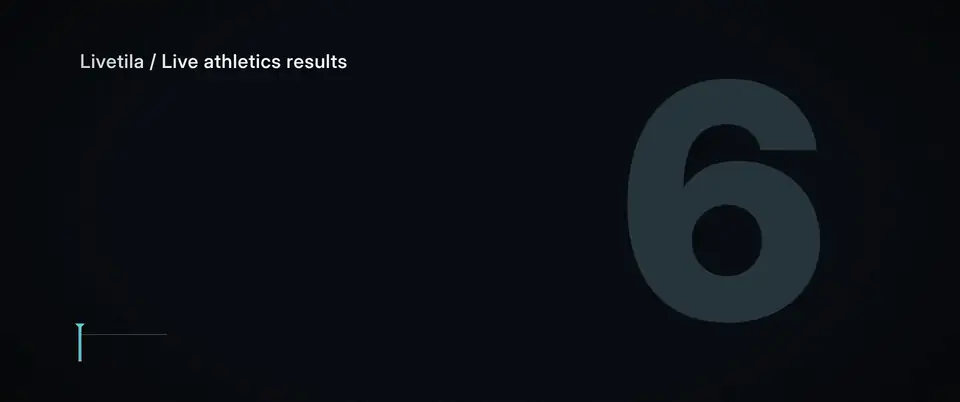

# Livetila

Live athletics results and streaming overlays (e.g. for OBS Studio), powered by the Tuloslista API.



## Development

Requires Node.js 22.12+ and pnpm.

```sh
cp .env.example .env   # set TULOSLISTA_API_KEY
pnpm install
pnpm dev
```

`pnpm check` runs typecheck and lint. `pnpm build && pnpm test` runs the browser tests.

## Overlays

```text
/overlay/[competitionId]-[eventId]?round=2&heat=1&style=ticker
```

`round` and `heat` are one-based; omit `heat` for overall results. `style` is `broadcast-trail-plain` (default), `ticker`, `broadcast-results` or `timetable`. `gap=0` hides gaps; `accent=5ed6cb` sets the accent colour.
